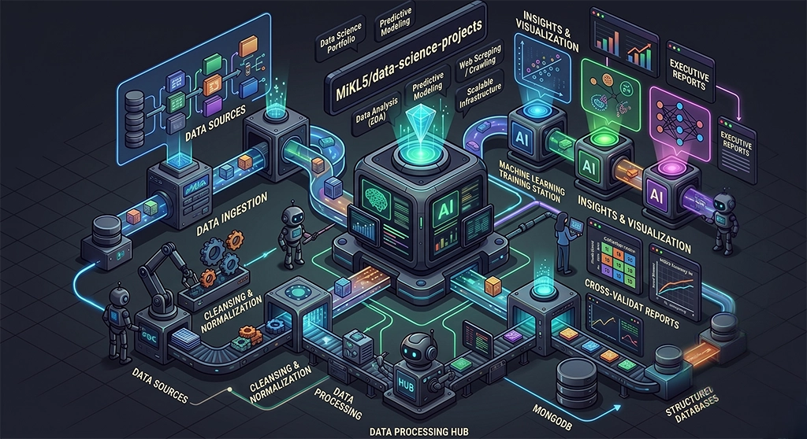

# Data Science 

<h2><b>Projets</b></h2>

[Analyse des données de Netflix](Anaconda/netflix)  
[Analyse des données des universités américaines](Anaconda/usUniversities)

## **📊 Data Science et Statistiques**
[Probailité et Statistiques pour la Data Science et Business](productivityAndStatistics4DataScienceAndBusiness)
## 📈 **Statistical Forecasting**
[Le climat quotidien à Delhi](forecasting/delhiClimateDynamics)

<h2><b>🔗 Disciplines connexes</b></h2>

🤖 [Intelligence artificielle](https://github.com/MiKL5/artificial-intelligence/)  
🧠 [Machine Learning](https://github.com/MiKL5/machine-learning-projects/)  
📊 [Business Intelligence](https://github.com/MiKL5/business-intelligence/)